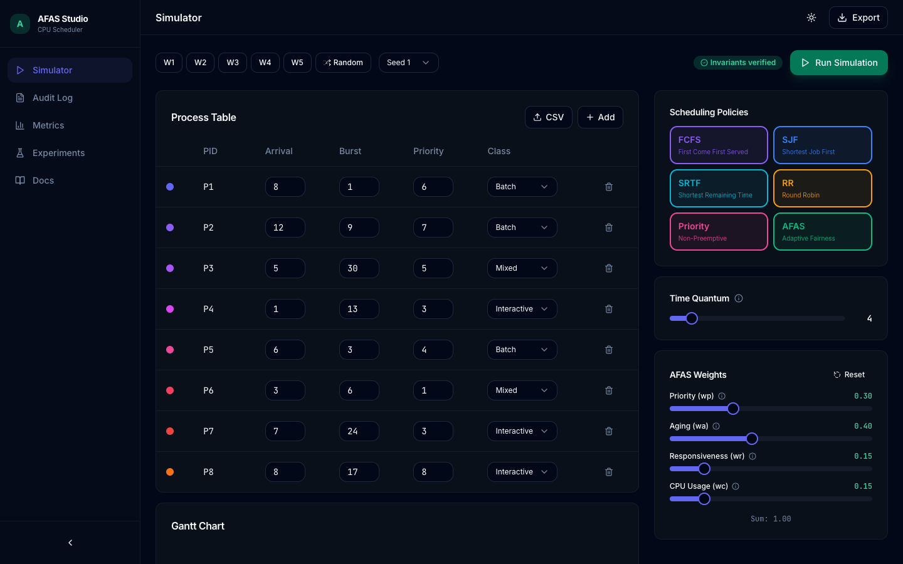
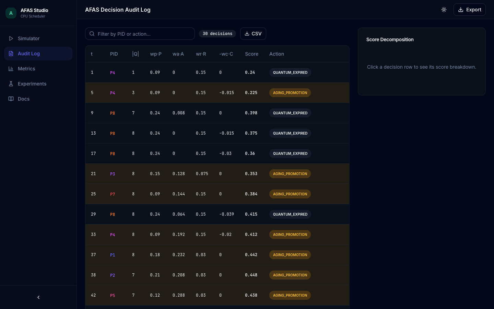
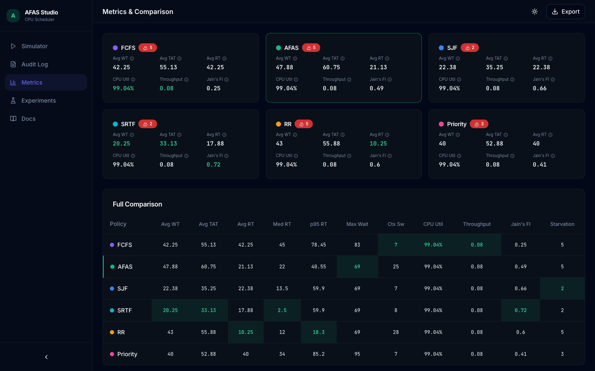
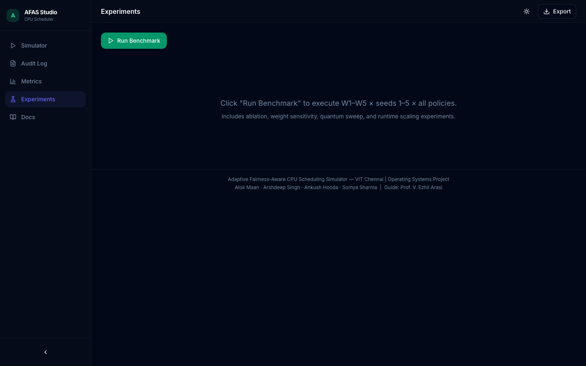
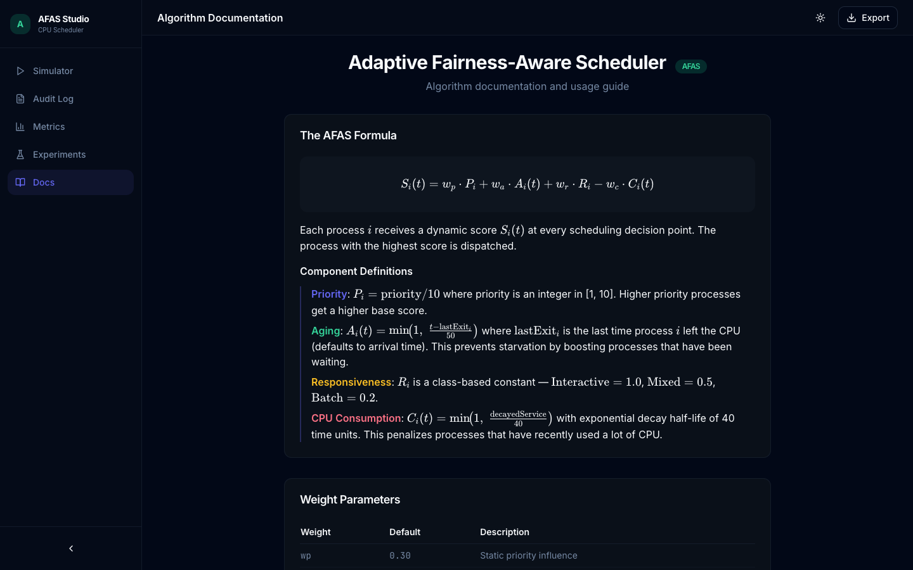

# AFAS Studio

**Interactive CPU Scheduling Simulator & Analytics Dashboard**

A production-quality web application for simulating and analyzing the **Adaptive Fairness-Aware Scheduler (AFAS)** alongside classic scheduling algorithms (FCFS, SJF, SRTF, Round Robin, Priority).

Built as part of the Operating Systems course project at **VIT Chennai**.


## Screenshots

### Simulator — Process Table & Controls


### Animated Gantt Chart — Side-by-Side Policy Comparison


### AFAS Decision Audit Log


### Metrics Dashboard — Policy Comparison


### Metrics — Charts & Visualizations


### Experiments — Benchmark & Sensitivity Analysis


### Algorithm Documentation (KaTeX)


---

## Features

### 🖥️ Simulator
- Editable process table with inline validation (PID, arrival, burst, priority 1–10, class)
- 5 preset workloads (W1–W5) with selectable seeds + random generation + CSV import
- Multi-policy selection for side-by-side comparison
- Animated SVG Gantt chart with context-switch markers and hover tooltips
- Step-by-step playback with Play/Pause/Step/Reset and 0.5x–8x speed control
- Scrubbable timeline and live ready-queue visualizer
- AFAS weight sliders with auto-normalization and time quantum control

### 📋 AFAS Decision Audit Log
- Every scheduling decision: time, PID, queue size, score decomposition (wp·P, wa·A, wr·R, −wc·C)
- Aging promotion detection highlighted in amber
- Stacked bar chart for score breakdown on any selected decision
- Click-to-jump: click a row to sync the Gantt playback
- Filterable by PID, exportable as CSV

### 📊 Metrics & Comparison
- Metric cards per policy: Avg WT, TAT, RT, Median RT, p95 RT, CPU Util, Throughput, Jain's Fairness Index
- Comparison table with best-in-column highlighting and AFAS emphasis
- Grouped bar charts, radar chart, and per-process detail table
- Starvation warnings (WT > 40 units)

### 🧪 Experiments
- Benchmark runner: W1–W5 × seeds 1–5 × all 6 policies with progress bar
- AFAS ablation study (no-aging, no-share variants)
- Weight sensitivity curves (one-at-a-time sweep for wp, wa, wr, wc)
- Quantum sweep (q = 1..32) comparing RR vs AFAS
- Runtime scaling analysis (N = 10..500)
- Export all results as JSON

### 📖 Algorithm Documentation
- AFAS formula rendered with KaTeX
- Component definitions, weight parameters, tie-breaking rule
- Pseudocode, usage guide, comparison policy descriptions
- Post-run invariant explanations

### 🎨 Design
- Dark/light theme with persistent toggle
- Inter + JetBrains Mono typography
- Tailwind CSS + shadcn/ui component library
- Framer Motion animations
- Fully responsive (desktop, tablet, mobile)

## Tech Stack

| Layer | Technology |
|-------|-----------|
| Framework | React 18 + TypeScript |
| Build | Vite 5 |
| Styling | Tailwind CSS 3 + shadcn/ui |
| State | Zustand |
| Charts | Recharts |
| Math | KaTeX |
| Animation | Framer Motion |
| Icons | Lucide React |
| Testing | Vitest |

## Quick Start

```bash
# Install dependencies
npm install

# Start development server
npm run dev

# Run tests (60 tests including hand-solved cases)
npm run test

# Production build
npm run build

# Preview production build
npm run preview
```

## Project Structure

```
├── src/
│   ├── engine/           # Pure scheduling engine (no UI deps)
│   │   ├── types.ts      # All TypeScript types and constants
│   │   ├── prng.ts       # Mulberry32 seeded PRNG
│   │   ├── scheduler.ts  # FCFS, SJF, SRTF, RR, Priority, AFAS
│   │   ├── metrics.ts    # Metric computation (Jain's, p95, etc.)
│   │   ├── invariants.ts # Post-run correctness checks
│   │   └── workloads.ts  # Preset workload generators
│   ├── store/store.ts    # Zustand global state
│   ├── components/
│   │   ├── ui/           # shadcn-style UI primitives
│   │   ├── layout/       # Sidebar, top bar, footer
│   │   └── simulator/    # Process table, Gantt, playback, etc.
│   ├── pages/            # 5 pages: Simulator, Audit, Metrics, Experiments, Docs
│   ├── lib/utils.ts      # Utility functions (cn, fmt, CSV/JSON export)
│   ├── App.tsx           # Router setup
│   └── main.tsx          # Entry point
├── tests/
│   └── engine.test.ts    # 60 unit tests
├── package.json
├── vite.config.ts
├── tailwind.config.js
└── vitest.config.ts
```

## Scheduling Engine

The AFAS formula:

**S_i(t) = w_p · P_i + w_a · A_i(t) + w_r · R_i − w_c · C_i(t)**

| Component | Formula | Description |
|-----------|---------|-------------|
| P_i | priority / 10 | Static priority (1–10 normalized) |
| A_i(t) | min(1, (t − lastExit) / 50) | Aging — prevents starvation |
| R_i | Interactive=1.0, Mixed=0.5, Batch=0.2 | Class responsiveness |
| C_i(t) | min(1, decayedService / 40) | CPU consumption penalty (half-life 40) |

**Default weights:** wp=0.30, wa=0.40, wr=0.15, wc=0.15

**Tie-break:** score desc → arrival asc → PID asc

### Invariants (verified after every run)
1. **Non-overlap** — no two Gantt blocks overlap
2. **Burst conservation** — total CPU time = declared burst per process
3. **No pre-arrival execution** — no process runs before arrival

## Tests

60 unit tests including hand-solved cases:

| Test Case | Expected |
|-----------|----------|
| FCFS completion times | [5, 8, 16, 22], mean WT = 5.75 |
| SJF completion times | [5, 8, 22, 14], mean WT = 5.25 |
| SRTF completion times | [8, 4, 22, 14], mean WT = 5.00 |
| RR (q=2) completion times | [9, 8, 5] |
| All 6 policies × 5 workloads | All invariants pass |
| Determinism | Same seed → same results |

## Deployment

### GitHub Pages

```bash
npm run build
# Deploy the dist/ folder
```

Set `base: '/your-repo-name/'` in `vite.config.ts` if deploying to a subpath.

### Vercel

```bash
# Install Vercel CLI
npm i -g vercel

# Deploy
vercel
```

No configuration needed — Vite projects are auto-detected.

## Team

| Name | Registration |
|------|-------------|
| Alok Maan | 24BCB0057 |
| Arshdeep Singh | 24BCE0556 |
| Ankush Hooda | 24BCE0966 |
| Somya Sharma | 24BCT0324 |

**Guide:** Prof. V. Ezhil Arasi  
**Course:** Operating Systems, VIT Chennai

## GitHub

[https://github.com/AlokMaan/OS](https://github.com/AlokMaan/OS)
